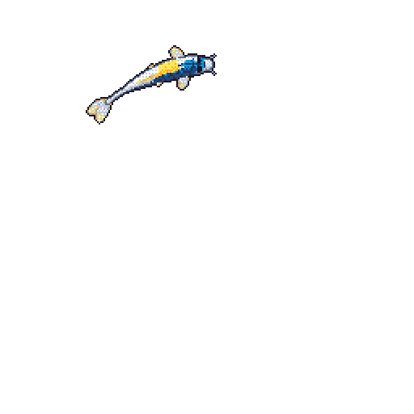
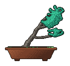

<!-- ## Hi!👋 I'm Atsal

<!-- 

 -->

## ♟️ when i'm not coding...

> probably blundering my queen.

<!-- chess-replay:start -->

 
<b>kirlur vs essyxx</b> · 1-0 · <a href="https://www.chess.com/game/daily/1045090630">View this game on Chess.com</a>

<!-- chess-replay:end -->

<a href="https://www.chess.com/member/kirlur">Challenge me on Chess.com</a>

<picture>
  
</picture>

<picture>
  
</picture>
<picture>
  
</picture>

 
<a href="https://github.com/kirlyr#year-list-container">
  <picture>
    <source media="(prefers-color-scheme: dark)" srcset="cards/stats-dark.svg">
    
  </picture>
</a>
<a href="https://github.com/kirlyr?tab=repositories">
  <picture>
    <source media="(prefers-color-scheme: dark)" srcset="cards/languages-dark.svg">
    
  </picture>
</a>
 
